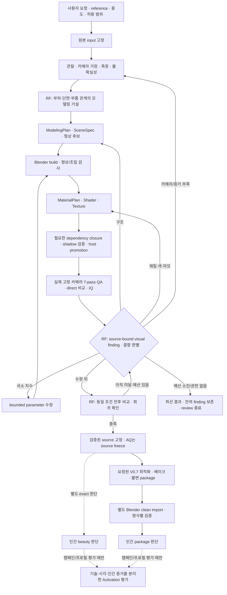

> 2026-09-30 프로젝트 보존용 열람본. 아래 평가는 당시 f55/0.9.0 상태의 기록이며 v0.9.1 검증으로 재분류하지 않습니다. 최신 종료·재개 기준은 [HANDOFF_KO.md](../../HANDOFF_KO.md)에 있습니다. 원본의 내용은 보존하고 링크만 프로젝트 보존본으로 연결했습니다.

# Reference-fidelity 작업 재평가와 중단 보고서

작성 기준: 2026-09-29, `E:\Playground\BlenderAssetGenerator`. 이번 보고서는 조사와 선택 가능한 계획이며 실행 권한이나 인간 품질 수용 기록이 아니다.

**현재 증거만으로 이 장기 개선 전체가 기존 사용 방식보다 충분한 이득을 만들었다고 판단하기는 어렵다.** 높은 점수가 잘못된 형상을 통과시키는 문제를 드러냈고, 일부 실제 외관 개선과 재사용할 가치가 있는 버그 수정을 얻었다. 그러나 기존 Standard 대비 평균 품질·납품 성공률·소요 시간·사용자 부담의 개선은 입증하지 못했다. **권고는 A: 이번 전체 캠페인을 종료하고, 유효 변경과 결과를 보존한 채 실제 자산 요청 중심의 사용으로 돌아가는 것**이다. 코드 삭제나 과거 버전으로의 checkout을 뜻하지 않는다.

## 조사 시점의 안전한 중단 상태

이미 실행이 멈춰 있었다. 기존 목표의 paused 상태를 유지했고, Blender/Python/uv 실행 및 프로젝트 관련 실행 프로세스가 발견되지 않았다. 진행 중인 promotion·rollback·package 작업을 강제 종료할 필요가 없었다. 새 작업 예약, host resume/cancel, state 수정, lock 삭제를 하지 않았다.

| 항목 | 직접 확인한 현재 상태 |
| --- | --- |
| 로컬 | `main`, HEAD `f55e739ec072b40dc2ed9c408292899087ca7ccb` |
| 변경 상태 | staged·unstaged·untracked 모두 없음 |
| GitHub main | `git ls-remote --heads origin main`으로 서버의 `9759cd4d380cb1c9a1ec0e2085e08a8c35e2657c` 확인. 로컬 저장 origin/main과 같음 |
| 차이 | 로컬이 40 commits 앞섬, 뒤처진 commit 0. fetch·push·config 변경 없음 |
| 위임 계약 | `1001de3434c20a9c195ee9daf29da0f8eff65ca98ba72cb3a99d4f826dba0274` 그대로. 승인 소스는 `ab39d9b`, 현재 소스와 다름 |
| Plastic | `aq_rf_ab39_01p`, session `aqv2-20260929t015114075784z-a16a0f35`, completed / terminal |
| Rust | `aq_rf_ab39_02r1`, session `aqv2-20260929t072456688907z-c6aa698d`, state `0007`, running / quality / run_integrated_quality. 실행 프로세스는 없음 |
| 과거 세션 | 실제 job의 AQ 최신 state 168개 중 비terminal 26개. 서로 다른 시기·실험·준비 상태가 섞여 있어 성공률의 분모로 쓰지 않음 |
| lock·quarantine | native AQ 및 위임 트리에서 `.lock` 0개, `.guard` 304개. guard 파일 존재는 OS lock 보유를 뜻하지 않음. 과거 gate-quarantine 디렉터리 2개는 비어 있음. 모두 보존 |
| 보존 확인 | 직전 Plastic·Rust·부모 계약 스냅샷 1,652개 파일, 705,719,605 bytes의 크기·SHA-256 일치 |

Rust JSON의 `running`을 임의로 `paused`나 `cancelled`로 바꾸지 않았다. 이번 요청의 안전한 중단은 **새 실행이 없고 현재 원자적 작업이 없는 상태를 유지하는 것**이다. 광범위 검색 중 접근할 수 없었던 과거 scratch 일부는 조사 범위에서 제외했으며 소유권·ACL을 변경하지 않았다. 따라서 모든 과거 임시 디렉터리까지 전수 확인했다고 주장하지 않는다.

서버 조회의 첫 시도는 Windows Schannel 자격증명 오류였고, 같은 읽기 전용 명령을 허용된 경로에서 재실행해 확인했다. 관련 근거는 [상태·40개 commit·308개 파일 목록](E:/Playground/BlenderAssetGenerator/reports/reference_fidelity_closeout/v0.9.1/archive/rf-reassessment-20260929-run01/STATE_AUDIT.json), [파일 보존·패키지·lock 추가 조사](E:/Playground/BlenderAssetGenerator/reports/reference_fidelity_closeout/v0.9.1/archive/rf-reassessment-20260929-run01/PRESERVATION_AND_LOCK_REVIEW.json)에 있다.

## 1) 무엇을 위해 시작했고 어떤 문제가 있었는가

### 기존 버전에서도 에셋 제작과 납품은 가능했다

GitHub main의 2026-09-01 버전은 이미 reference 분석, ModelingPlan·SceneSpec, Blender build, 재질·텍스처, 실제 QA 렌더, 수정, 최적화·베이크, GLTF/FBX/OBJ package 및 clean import를 갖고 있었다. Standard의 다중 시점 구조 검토와 수동 보호 수정, AQ·One-Prompt·Approval Envelope의 실험적 자동 진행도 이미 존재했다. 이번 40개 commit이 전체 파이프라인을 처음 만든 것이 아니다.

실제 이전 결과도 남아 있다.

- `collectible_wood_03_standard`: 이번 캠페인과 **같은 목재 reference**로 부피·단면·나뭇결을 가진 모델을 만들었고, FBX package 33개 파일의 해시와 passed clean import를 이번에 확인했다.
- `item_standardgun_heavy`: 기존 GLTF package 26개 파일과 passed clean import를 확인했다.
- `item_plastic_standard_canary_01`과 `collectible_cloth_01`: GitHub 버전의 machine evidence에 실제 인간 beauty 수용과 최종 package 승인이 기록돼 있다. 잔존 silhouette·UV·교환 형식 한계도 함께 수용한 결과다. 이번에 최종 package approval 원본을 읽어 확인했다.
- 별도 R5D Laser는 2026-09-01 exact technical recovery package 수용 receipt가 있다. 원래 실패한 AQ delivery terminal은 유지됐다. 이 package 수용은 profile Activation 수용과 다르다.

따라서 “예전에는 좋은 에셋을 만들거나 납품할 수 없었다”는 설명은 틀리다. 다만 workspace는 실행 클라이언트를 모두 증명하지 않으므로 이 기록 전체를 ChatGPT Work에서 실행했다고 단정하지 않는다. **Work/Codex는 작업하는 에이전트·클라이언트이고, Standard/AQ는 저장소의 작업 경로**다. Work=Standard, Codex=AQ라는 구분도 맞지 않는다. [이전 Standard 실증](E:/Playground/BlenderAssetGenerator/verification/evidence/skill_orchestration_standard_20260826/standard_asset_evidence.json), [R5D 실제 package 수용](E:/Playground/BlenderAssetGenerator/workspaces/aq_stage9_prep_r5d_01_laser_perspective_canary/optimization/runs/delivery-plan-aqv2-20260831t115126214507z-605fc5bf-gltf-run/package_acceptances/r5d-recovery-r06-gltf/acceptance.json)

### 직접적인 출발점: 자동 캠페인의 높은 점수와 잘못된 부피

기술적 5/5 production·clean import에 도달한 AQ 캠페인에서도 목재가 입체적인 부러진 보 대신 **얇은 판과 가는 막대**처럼 만들어졌다. Rust의 절곡 부피, Crystal의 내부/단면 표현도 문제로 기록됐다. 겉 윤곽이 비슷하고 파일이 정상 생성되는 것만으로는 reference를 제대로 재현했다고 할 수 없었던 사례다. 9월 5일 작업의 중심이 Activation 진행에서 관찰·형상 저작·수정 루프 개선으로 이동했다. [당시 목표 전환](E:/Playground/BlenderAssetGenerator/ROADMAP_V1_KO.md:24), [직접 재현](E:/Playground/BlenderAssetGenerator/VERIFICATION_REFERENCE_FIDELITY_KO.md:66)

문제의 Wood V0.6 direct score는 약 **0.989347**이었다. 이 값은 구조의 정답 여부가 아니라 주로 렌더된 silhouette와 화면상의 bounding box 일치도를 평가한다. 구현은 legacy에서 silhouette 75% + 전체 bbox 25%, semantic 관측이 있으면 silhouette 60% + 전체 bbox 15% + 부품 bbox 25%다. 목재가 두꺼운 보인지, 파손 단면이 실제로 입체인지, 보이지 않는 쪽이 올바른지는 이 점수만으로 보장되지 않는다. [실제 점수 계산](E:/Playground/BlenderAssetGenerator/src/codex_blender_modeler/qa/direct_compare.py:24)

Integrated Quality의 구조 검사는 선언된 제약·조립 관계·mesh preflight를 확인한다. **애초 모델링 가설이 틀렸지만 수치적으로 유효한 모델**은 이 검사를 통과할 수 있다. 새 visibility 검사는 내부 edge·명암·고주파 신호 부족을 보완하지만, 텍스처가 복잡해졌다는 사실이 올바른 입체 구조라는 뜻은 아니다. 실제 7-pass 이미지가 있다는 사실과 그 의미를 올바르게 판단했다는 사실도 별개다.

이는 보·관·접힌 판·결정·부품 조립처럼 부피와 단면이 정체성을 결정하는 자산에서 중요하다. 사용자는 한 뷰에서는 그럴듯하지만 회전시키면 납작한 모델, 속이 비거나 면이 뒤집힌 관, 색과 마모가 reference와 다른 자산을 뒤늦게 발견하고 다시 수정하게 된다. 다만 **일부 AQ 사례의 실패를 기존 Standard 결과 전체의 실패로 확대할 근거는 없다.** 이전 Standard 목재가 이미 입체적이었다는 증거가 그 반례다.

### 목표는 세 층으로 커졌다

| 구분 | 내용 |
| --- | --- |
| 직접 원래 목표 | reference 관찰을 부피·단면·부품 관계의 가설로 만들고, 실제 렌더에서 잘못된 구조를 찾아 형상 자체를 수정한다. 재질 수정으로 구조 오류를 덮지 않는다 |
| 도중 추가·확대된 목표 | 결함별 V0.4/V0.5 자동 재진입, 동일 조건 비교, 유한 예산, 전략 전환, scope·receipt·소스 결속, cross-session 소비 보존, 장기 캠페인 위임, 버그 복구, storage retention, 새 baseline과 Activation 실증 |
| 현재 미달 목표 | 한 고정 baseline에서 5자산 모두의 실제 개선·production·package·clean import를 완성하고 인간 beauty·package·Activation을 따로 평가. 현재 `f55e739`에서는 자산 실행 0/5 |

마지막 행은 엄격한 캠페인 자격을 입증하는 목표다. 일반 사용자가 좋은 단일 자산 하나를 얻는 데 항상 필요한 목표는 아니다.

## 2) 전체 파이프라인은 어떻게 작동하는가

아래는 실제 구현의 공통 제작 경로와 선택적 AQ 확장을 연결한 흐름이다. `RF` 표시는 이번 로컬 개선이 보강한 지점이다. 모든 자산이 모든 선택 기능을 사용하는 것은 아니다.

첫 QA부터 수정이 필요 없으면 검증된 source로 진행할 수 있다. 다만 이번 캠페인의 **paired improvement** 주장은 유효한 수정 전후 근거를 추가로 요구한다. 도표의 화살표는 무제한 반복을 허용하지 않는다. AQ는 계약·예산·반복 실패 조건에 따라 종료한다.

| 단계·목적 | 주요 입력 → 출력 | 담당 주체 | 수정이 필요하면 |
| --- | --- | --- | --- |
| 요청·원본 고정 | reference·요구·용도 → job/input·범위 | 사용자 + host | 내용 범위 변경은 별도 명시적 결정. 원본 교체 금지 |
| 관찰·카메라·측정 | 이미지·치수 anchor → 진단·observed/inferred 정보·camera assumptions | Work/Codex의 시각 판단 + host의 이미지 진단·수치 검증 | 관찰·카메라 재검토. 새 조건은 과거 비교와 구분 |
| 계획·형상 저작 | 부품 분해·관계·가설 → ModelingPlan·SceneSpec 0.2·허용 geometry payload | Work/Codex 작성, host schema·권한 검증 | 구조 가설/형상 단계로 돌아감 |
| build·형상 검사 | SceneSpec·geometry payload → blend·inventory·validation·선택적 다중뷰 | host가 제한된 builder 실행, Blender가 실제 생성 | 잘못된 부피·접합은 geometry, 수치만 틀리면 parameter 수정 |
| 재질·텍스처 | 승인/검증된 geometry·material identity → MaterialPlan·ShaderRecipe·TextureManifest | Work/Codex 저작, host 검증, Blender compile | 색·마모는 material; identity/UV 의존성 문제는 정해진 복구 경계 |
| dependency closure | 재질 그래프·텍스처·source hashes → closure·preflight·shadow compile·promotion receipt | 결정론적 host + 실제 Blender | 누락/오결속은 기술 복구. 사용자 품질 수용으로 해결하지 않음 |
| 실제 QA·IQ | 정확한 build·camera·render conditions → beauty 포함 7-pass·V0.6·IQ 4축 | Blender 렌더, host 수치 평가, Work/Codex 이미지 해석 | 결함 종류에 맞는 경로. IQ 숫자 상승만으로 완료하지 않음 |
| finding·수정·비교 | source-bound finding·전후 실제 렌더 → resolved/remaining/regression·best-known | Work/Codex가 관찰 작성, host가 출처·조건·예산·허용 연산 검증 | 구조→V0.4, 재질→V0.5, 국소→parametric. 정체/소진 시 안전 종료 |
| source 고정 | 통과한 품질 근거·promotion receipt → frozen exact source | host. AQ는 source_freeze/quality terminal | source가 바뀌면 관련 검증 필요. 과거 freeze 수정 금지 |
| 최적화·베이크·package | 요청 형식·고정 source·정확한 plan 권한 → 파생 mesh/maps·불변 manifest/package | host + Blender | 원본을 고치지 않고 파생 납품 경로의 한정 복구 |
| clean import | 정확한 형식별 package → 새 Blender import·bounds/semantic/material 등 결과 | 별도 Blender 실행 + host 비교 | 그 형식의 package 문제로 복귀. 다른 형식의 pass 차용 금지 |
| 인간 판단 | exact beauty / manifest+clean import / Activation 근거 → 각각의 인간 결정 | 사용자 | needs_revision이면 허용 범위 안에서만 수정. 자동 정책과 구분 |

### 공유 기능과 AQ가 추가하는 것

Standard와 AQ는 같은 V0.4 형상, V0.5 재질, V0.6 QA, V0.7 납품 기능을 쓴다. Standard는 기본 경로다. AQ는 별도의 만능 모델러가 아니라 **후속 단계를 진행시키는 자동화 계층**으로 controller assignment, 예산, single-use policy, 재개, 실패·review terminal을 추가한다. 초기 위임 아래 host가 발급하는 정책 권한은 인간 beauty·package 수용이 아니다.

현재 AQ v2·One-Prompt·reference-fidelity/delegation의 관련 profile은 `disabled_experimental`이다. derived SceneSpec V03 구조 연산, ImageGen, interior, external intake, destination handoff 등은 선택 기능이다. 사진 한 장은 숨은 면과 절대 치수를 증명하지 않는다. measured 모드는 실제 측정 anchor가 있을 때만 의미가 있다.

저작의 원본은 `.blend` 하나가 아니라 immutable input과 versioned JSON 계약이다. `.blend`, QA 이미지, 진단 보고서, 최적화 장면, baked map, package는 파생 산출물이다. 후보 staging은 canonical이 아니며 authorized host promotion이 검증 후 canonical을 바꾼다. 새 결과는 기존 QA/receipt/package를 덮어쓰지 않는다. [원본·버전 경계](E:/Playground/BlenderAssetGenerator/docs/agent/source_of_truth.md), [Standard/AQ 실제 단계](E:/Playground/BlenderAssetGenerator/docs/agent/workflow_reference.md), [납품 경계](E:/Playground/BlenderAssetGenerator/docs/agent/packaging_and_handoff.md)

### Plastic 하나가 실제로 완성된 경로

직전 `ab39d9b`에서는 기존 최선 형상·고정 관찰을 활용해 Plastic 초기 후보를 build하고 재질 closure 뒤 실제 QA를 렌더했다. 남은 문제는 구조가 아니라 파란 몸체와 테두리의 색 불일치, 이어진 넓은 회색 마모 띠였다. 형상·camera·lighting을 유지한 V0.5 재질 수정 한 번 후 실제 렌더를 비교했고, source-bound finding과 paired comparison을 기록했다. IQ 값은 **0.982965로 동일**했지만 이미지에서 색의 일관성과 마모 분포 개선이 확인됐다. host source freeze 후 portable GLTF package 및 별도 Blender clean import를 완료했다.

이 예에서 **외관을 바꾼 것은 재질 저작 내용**이다. 계약·hash·receipt는 그 수정이 어느 source에 대해 이뤄졌으며 무엇을 검증했는지 보장한다. 관리 구조가 스스로 색이나 형상을 좋게 만드는 것은 아니다. 인간 beauty·package·Activation 수용은 아직 없다. [정확한 Plastic 결과](E:/Playground/BlenderAssetGenerator/reports/reference_fidelity_closeout/v0.9.1/archive/rf1001-20260929/evidence/plastic/RESULT_KO.md)

## 3) GitHub 버전과 지금 로컬 버전은 무엇이 다른가

원격부터 로컬까지 40 commits, 변경 파일 308개다. 순수 diff는 +56,443/-1,295 lines이며 source 116개, tests 77개, schema 67개, docs/skills/config 33개, scripts 13개, 생성 projection 2개로 분류했다. **작업량·유지보수 범위를 보여주는 수치일 뿐 품질 성과가 아니다.** 9월 2일의 Activation·납품 수정과 9월 9일 storage retention도 들어 있어 40개 모두를 reference 외관 개선으로 세면 안 된다.

| 사용자 가치 분류·주요 변경 | 추가된 이유와 기존 대비 차이 | 확인한 효과와 적용 범위 | 복잡성·권고 |
| --- | --- | --- | --- |
| **직접 형상 저작**: 구조 가설·Wood 전략, bounded triangulated shell (`ad4e5e8`, `24632c6`) | 윤곽만 맞춘 평면을 실제 단면/부피로 다시 저작할 수 있게 함 | 격리 Wood 재저작과 후속 shell 자산에 사용. shell은 일반 형상 수단이지만 자동으로 좋은 형상을 보장하지 않음 | 새 payload·limit·builder·테스트 비용. 유용한 수단은 보존하되 일반 효과 확인 필요 |
| **평가**: visibility, source-bound visual finding, 비교 조건 (`7359ce7`, `ad4e5e8`) | high-IQ이면서 평평한 결과를 발견하고, 같은 source/조건의 실제 개선 여부를 분리 | 잘못된 Wood와 현재 Rust를 통과 점수만으로 완료 처리하지 않음. Plastic 재질 개선을 점수 외에 기록 | agent의 관찰 품질에 의존. 복잡한 schema가 시각 판단을 대체하지 않음 |
| **평가 입력 보정**: bbox overlap, mask seed·trimap, explicit lighting (`47e3928`, `df8b151`, `0feae89`, `493f934`) | coarse contact/마스크 오염·조명 불일치가 비교를 왜곡하는 문제 | 특정 reference의 segmentation/비교 재현성에 도움 | bbox overlap은 실제 접합 정답 아님. 마스크·조명 조정으로 점수만 좋아질 위험. 일반 기본값 도입은 보류 |
| **실제 geometry 버그**: multi_loop winding (`f55e739`) | 정규화한 hole을 다시 반전하고 Y축 변환 방향을 놓침 | 실제 Rust 관의 내부 면 64개 오방향·edge conflict 128개 재현. 수정 후 Blender cap/축/입력 방향 19 fixture 충족 | 제품 메서드 1개 수정. 유지 가치 높음. 현재 Rust 완성 렌더의 개선 증거는 아직 없음 |
| **납품/Windows 버그**: split-normal 허용오차·corner 비교·긴 경로 (`4bb2ce3`~`5e5b172`, `2da54cb`, `d0da720` 등) | float 직렬화 오차의 거짓 실패, deep shader/image/geometry 경로 오류 | 실제 failure와 재현·gate 근거 존재. 같은 플랫폼·형식 사용자에게 직접 유용 | 플랫폼 분기와 회귀 검사 비용. 실제 차이를 무시하는 완화와 구분해 유지 |
| **제작·재진입 버그**: baseline blend 역할, IQ route, material closure의 라운드/receipt 결속, controller 재개 (`2ae76d2`, `b617bae`, `e37f230`, `e93eea7`, `1a07abc`, `8e66fa1`) | 구조를 바꾼 후 이전 재질/receipt를 잘못 쓰거나 다음 phase가 막힘 | 복구·stale 거부·canonical 보호의 실행 근거. 주로 AQ/closure 경로에 필요 | 원래 경로 통합의 누락을 후속 수정한 부분. 각각을 독립 외관 향상으로 계산하지 않음 |
| **실행 관리**: Activation·publication·human review terminal (`f7226f1`, `84e5858`, `b9a314f`) | technical success와 인간 수용/활성화 의미 혼재 방지 | 기록 의미를 분리하는 이득. 보통 Standard 단일 자산에는 전체 캠페인 구조 불필요 | 별도 registry/index/readiness/approval 계층. 실험 프로필 운영 목적에 한정 |
| **실행 관리**: 초기 비용 산정·finite correction·delegation (`c8b1507`, `03f5b93`, `668aec4`, `aa4e9f0`, `aa22b13`, `ab39d9b`) | 필요한 수정 전에 예산 소진, 개별 scope 승인 반복, 이름 변경으로 소비 리셋 위험 | 남은 비용을 사전 산정하고 위임 내 child 발행 자동화. 현재 1001에서 2개 scope 진행. 전체 시간/개입 감소는 미입증 | 여러 예산/예외/계보의 결합. 현재 새 source 연결을 막는 제약도 발생. 추가 확장은 보류 |
| **운영**: storage retention (`a680633`) | 장기 실험의 scratch 누적과 저장공간 부족 | 이전 정리의 약 28.30GB 확보는 운영 성과. 이번 조사에서는 정리하지 않음 | inventory/계획/receipt 체계 유지 비용. 에셋 외관 성과와 별도 |
| **테스트·문서·생성 파일** | 호환성·회귀·public surface 동기화 | 버그 수정과 의미 보존의 신뢰 근거 | 테스트 수는 품질 상승량 아님. 매번 full gate 재실행하는 근거로 쓰지 않음 |

후속 수정으로 보완된 같은 문제도 있다. `2da54cb`의 확장 경로 처리는 `d0da720`에서 범위를 다시 제한했다. `1899ce9`→`ac4b6de`→`07efa1a`는 fidelity preview와 그 의존성·runtime 결속을 단계적으로 닫은 흐름이다. 초기 budget→finite epoch→skill 전달→delegation→계보 보존도 하나의 실행 문제를 점차 넓힌 연속 작업이다. 중복된 사용자 이득으로 합산하지 않는다.

**유지 우선:** 재현된 winding, 경로, 정상적인 GLTF의 거짓 실패, stale/atomic promotion 보호 및 관련 회귀 검사. **효과 확인 대상:** 새로운 구조 저작 전략과 visual finding을 사용한 자동 수정, shell·mask·lighting의 일반화. **일반 도입 보류:** reference-fidelity 캠페인/추가 위임 계층을 모든 자산의 기본 사용 조건으로 삼는 것, 검증되지 않은 자동 Activation. 변경 사이 의존성이 있으므로 이 제안만으로 selective cherry-pick·삭제·롤백을 실행하면 안 된다. [40개 commit별 분류](E:/Playground/BlenderAssetGenerator/reports/reference_fidelity_closeout/v0.9.1/archive/rf-reassessment-20260929-run01/CHANGE_REVIEW_KO.md)

## 4) 실제로 얻은 성과와 입증하지 못한 부분은 무엇인가

### 실적을 baseline과 판정별로 분리

| 증거 묶음 | 기술·납품 | 실제 시각 개선 | 인간 판단 |
| --- | --- | --- | --- |
| GitHub 이전 Standard | Wood FBX, 총기 GLTF, 별도 Plastic/Cloth E2E 존재 | 이미 입체적 형상·재질과 사용자 수용 가능한 결과. 현행과의 통제 A/B는 아님 | Standard Plastic/Cloth beauty 및 최종 package 수용 있음. R5D Laser도 별도 beauty·package 수용 이력. 새 캠페인 수용으로 승계하지 않음 |
| 과거 `5e5b172` fix3 AQ | 5/5 completed production·package·clean import 기록. 이번 최신 state 5개 completed 확인 | 이 기술 성공에도 Wood 부피 문제가 남음 | 해당 결과를 새로운 인간 수용으로 재분류하지 않음 |
| A~D 격리 개발 | 5종의 source-bound finding·수정 루프 비교 근거 | 각 자산의 비인간 개선/부분 개선 기록. Wood 일부는 direct score가 내려가도 부피가 개선됨 | 개발 실증이며 5개 current-baseline production/인간 수용이 아님 |
| `47e3928` 캠페인 | Plastic production 1/5, review terminal 3/5, Laser 기술 실패 1/5 | 개선 입증 1/5 | beauty·package·Activation 수용 각각 0/5 |
| `24632c6` 캠페인 | Plastic·Rust production/package/import 2/5. Wood 후속은 review 종료 | exact scope의 고정 조건 cross-job pair에서 Plastic·Rust 개선 기록. 같은 session 수정 성공과 구별 | 두 closeout의 beauty·package·Activation 모두 not_recorded |
| 직전 `ab39d9b` / 계약 1001 | Plastic 1/5 완료. Rust는 quality 단계 미종료 | Plastic 1/5, 같은 geometry/camera/lighting의 실제 재질 개선. Rust 미달 | beauty·package·Activation 각각 0/5 |
| 현재 `f55e739` | 새 자산 실행 0/5. winding 코드·fixture 검증만 완료 | 새 baseline의 paired improvement 0/5 | beauty 0/5, package 0/5, Activation 0/5 |

`ab39d9b`의 인간 beauty·package·Activation도 각각 0/5다. 현재 baseline의 0/5를 전체 누적 성공 0/5로 설명하지 않는다. 반대로 과거 completed나 인간 수용을 현재 baseline에 자동 승계하지도 않는다. 과거 4bb 캠페인의 5개 exact beauty `needs_revision` 기록도 그대로 유지한다. [원래 인간 판단](E:/Playground/BlenderAssetGenerator/reports/activation_readiness/fresh_campaign/aq-first-completion-4bb2ce3/human_disposition_set.json)

현재 소스 검증은 코드 수정의 신뢰도를 높이지만 자산 완성을 증명하지 않는다. 직전 전체 Python 2,605 passed 및 실제 Blender 회귀가 있고, AQ native 첫 gate에는 종료 timeout 실패가 남아 있다. 같은 소스의 실패 node 재실행은 통과했으나 첫 failed gate를 pass로 바꾸지 않았다. 이번 조사에서는 이를 재실행하지 않았다. [수정·검증·한계 원본](E:/Playground/BlenderAssetGenerator/reports/reference_fidelity_closeout/v0.9.1/archive/rf-winding-fix-20260929-run01/evidence/REPORT_KO.md)

### 사용자 가치별 평가

| 항목 | 확인된 이득 | 미입증·남은 한계 |
| --- | --- | --- |
| reference 시각 유사성 | Plastic 최근 결과는 이전 Standard보다 외곽·테두리·마모가 reference에 가까워 보이며, ab39 내부 전후 색·마모 개선도 확인 | 이전 Standard와 현행의 카메라·조명·작성 노력 차이로 코드 버전의 인과 효과/평균 우월성은 미입증 |
| 부피·단면·부품 관계 | 평면 Wood 실패를 식별하고 입체 후보를 만들었음. 관 winding 결함을 재현·수정 | 이전 Standard Wood도 이미 입체적. 최신 Wood는 파손 단면·풍화가 미달. 수정 builder로 실제 Rust 완성은 미검증 |
| 재질·색·마모 | Plastic의 부자연스러운 색 경계와 연속 회색 띠를 완화 | 원본 사진의 긁힘 배치·마모 폭·거친 표면은 정확히 같지 않음. Rust 분포 finding도 남음 |
| 생성→납품 성공률 | 일부 실제 납품 실패 원인을 수정했고 Plastic 끝단 경로 완료 | 대조군·같은 조건의 시행 집합 부재. 여러 baseline의 1/5·2/5·5/5를 합쳐 개선율 계산 불가 |
| 수정 시간·실행 비용 | 결함 종류별 route와 비용 사전 산정 가능 | 기존 Work/Standard보다 빨라졌다는 측정 없음. 총 사람 시간·토큰·GPU 비용 원장 부족 |
| 사용자 개입·승인 | 위임 계약 안의 routine scope·promotion·package 자동 처리 구현 | 전체 개입 감소는 미입증. 앞선 긴 exact scope 승인·재기준 설정 부담이 실제로 발생 |
| 재현성과 보존 | source-bound pair, receipt 라운드 결속, 과거 소비·결과 보존을 강화 | 기존에도 versioned evidence/package가 있었음. 새 source 연결이 더 엄격해져 유용한 결과 재활용도 막을 수 있음 |

새 이미지·점수는 만들지 않고 원본을 직접 확인했다. [기존/개선 결과 이미지와 비교 한계](E:/Playground/BlenderAssetGenerator/reports/reference_fidelity_closeout/v0.9.1/archive/rf-reassessment-20260929-run01/VISUAL_EVIDENCE_KO.md)에 같은 reference의 Standard Plastic·Wood, 실패한 AQ Wood, 후속 Wood, ab39 Plastic 전후를 모았다. 서로 조건이 다른 그림에는 “엄밀한 전후”라는 이름을 붙이지 않았다.

### 비용: 소비, 예약, 품질을 구분

계약 1001의 entry history에 기록된 **이전 회계값**은 다음과 같다. 8월의 이전 AQ 이력도 포함하므로 40개 commit 이후만의 실행량이 아니다. 개발용 격리 실행·전체 테스트를 모두 포함한 요금 원장도 아니다. initial candidate 수는 시도 수이며 독립적인 새 디자인 수로 해석하지 않는다.

| 자산 | 이전 initial candidate | build 회계값 | 별도 closure/preflight 회계값 | QA 회계값 |
| --- | ---: | ---: | ---: | ---: |
| Plastic | 47 | 396 | 104 | 87 |
| Rust | 19 | 189 | 66 | 37 |
| Wood | 25 | 160 | 60 | 39 |
| Crystal | 14 | 120 | 0 | 12 |
| Laser | 13 | 125 | 0 | 13 |
| 합계 | 118 | 990 | 230 | 188 |

이는 관리 원장이 보존하는 투입 이력이지 성공·품질 개선 수가 아니다. 금전·시간으로 환산하지 않았다. [집계 범위·원래 계약 연결](E:/Playground/BlenderAssetGenerator/reports/reference_fidelity_closeout/v0.9.1/archive/rf-reassessment-20260929-run01/COST_REVIEW.json)

계약 1001에서 추가로 실제 수행한 Plastic은 후보 1, 재질 수정 1, AQ build 8, 별도 closure 12, QA 2, promotion 3, delivery 1이다. Rust는 후보 1, AQ build 8, closure 6, promotion 2이며 실제 7-pass QA 1회가 있다. Rust state의 quality counter가 아직 0이라고 이 렌더를 없던 일로 처리하지 않는다.

1001의 총 예약 상한/현재 부모에서 예약한 양/미예약 잔여는 후보 **9/2/7**, AQ build **261/36/225**, closure **186/42/144**, QA **93/21/72**, promotion **52/11/41**, delivery **9/2/7**이다. controller는 61/13/48, actions는 648/144/504다. 자산별 미예약 후보는 Plastic 0, Rust 1, Wood·Crystal·Laser 각 2다. 이전 부모의 예약도 별도 승계돼 있으며 미사용분을 환급하지 않는다. “아직 숫자가 남는다”는 것이 현재 source에서 실행할 권한이 있다는 뜻은 아니다.

한정된 검색 범위인 `campaign_scopes/*/scope_user_decision.json`만으로도 승인 기록 24개가 확인됐다. 전체 사용자 상호작용 수는 아니지만 이 과정의 승인 부담을 보여준다. 9월 2~29일 commit 이력은 경과 기간일 뿐 노동 시간 측정값은 아니다.

**투자 대비 답변:** 개별 이득은 확실히 있다. 특히 점수의 맹점 발견, Plastic의 실제 수정, 실제 관 메시 버그 및 납품 실패 수정은 남길 가치가 있다. 그러나 이 이득을 얻기 위해 늘어난 반복 실행·scope 승인·source 재고정·관리 코드 비용까지 고려하면, **장기 프로그램 전체가 기존 사용법보다 충분히 낫다는 결론은 현재 미입증**이다. 이미 쓴 비용은 다음 작업을 정당화하는 이유가 될 수 없다.

## 5) 작업이 길어진 이유와 불필요하게 커진 부분은 무엇인가

1. **서로 다른 성공을 하나의 종착점에 묶었다.** 좋은 모델, 정상 AQ terminal, 패키지 교환, 인간 수용, 새 baseline의 5자산 Activation 적격은 다른 목표다. 앞 단계에서 유용한 결과가 생겨도 뒤 자격 요건 때문에 캠페인을 계속하게 됐다.
2. **형상 문제와 평가 문제를 교대로 만났다.** 윤곽 점수는 높지만 평면인 Wood, 마스크가 잘못된 비교, 조명 조건 차이를 구분해야 했다. 해결 과정에서 trimap·조명·finding 계약이 추가됐다. 평가를 올바르게 만드는 일은 필요하지만 실제 형상 저작보다 크게 확장됐다.
3. **제작 경로의 비용·결속을 처음부터 충분히 반영하지 못했다.** 초기 build뿐 아니라 closure의 별도 Blender 호출, 다시 QA, promotion을 감당해야 했다. 재진입에서 old material receipt·baseline role·controller authority 문제도 드러났다. 일부 추가 코드는 새로운 품질 기능보다 기존 통합 누락을 수선한 것이다.
4. **공통 코드 수정과 캠페인 권한이 강하게 결합돼 있다.** 버그 한 개를 고쳐도 source가 달라지고, 새 baseline·readiness·canary 요구가 생긴다. 이미 완료한 Plastic 재검증까지 새로운 candidate 비용을 요구한다. 반복적인 source reset은 에셋이 좋아지는 작업과 같은 것이 아니다.
5. **유한성을 지키려 만든 계약이 현재는 정당한 재개도 막는다.** 새 successor는 같은 reference 집합, 각 asset 최소 slot 1, 이전 admitted session의 exact outcome을 요구한다. Plastic 잔여 slot 0과 미종료 Rust가 함께 있어 기존 host로 새 source를 연결할 수 없다. 이는 “예산을 더 주면 해결”이라는 문제가 아니다. [source 검증](E:/Playground/BlenderAssetGenerator/src/codex_blender_modeler/autonomy_v2/delegation_service.py:136), [predecessor 조건](E:/Playground/BlenderAssetGenerator/src/codex_blender_modeler/autonomy_v2/delegation_service.py:229), [slot 최소 조건](E:/Playground/BlenderAssetGenerator/src/codex_blender_modeler/autonomy_v2/delegation_models.py:119)
6. **검사/문서/준비 완료가 실제 개선 완료처럼 느껴지기 쉬웠다.** full tests, clean commit, receipt 발행은 신뢰 근거다. 사용자가 만족할 에셋을 만드는 효율이나 아름다움을 직접 측정하지 않는다. 안전한 review 종료 역시 좋은 실패 처리이지만 납품 성공은 아니다.

현재 Plastic pair를 새 baseline에서 그대로 재검증하는 native 예약 비용조차 후보 1, build 8, closure 12, QA 6, promotion 3, controller 4, delivery 1, action 72다. 외관을 더 좋게 만들려는 작업이 아니라 **새 baseline 자격을 다시 입증하는 비용**이다. Plastic 후보 잔여 0에 들어가지 않는다. 여기서 자동으로 새 부모·epoch·전체 재시작을 추가하는 것은 권하지 않는다. [기존 host 연결 불가와 정확한 비용](E:/Playground/BlenderAssetGenerator/reports/reference_fidelity_closeout/v0.9.1/archive/rf-winding-fix-20260929-run01/evidence/successor-feasibility.json)

## 6) 앞으로 어떤 방향이 합리적인가

아래는 **미실행 제안**이다. 모든 방향에서 과거 후보·수정·전략 전환·예약 소비를 유지하고, 완료 Plastic을 다시 만들지 않는다. source 변경·push·계약 발행 권한은 이 보고서에 없다.

| 방향 | 목적·기대 이득 | 비용·위험 | 필요한 결정 | 완료·중단 조건 |
| --- | --- | --- | --- | --- |
| **A. 전체 개선 캠페인 종료 — 권고** | 유효 버그 수정·완료 자산·증거를 보존하고 실제 사용자 요청 중심 Standard 사용으로 복귀 | 새 후보·render·QA·delivery 0. 자동 5/5 실증 목표는 미완료로 남음. GitHub와 로컬 차이의 통합 여부는 별도 과제 | 5자산 Activation 입증을 현재 목표에서 내려놓을지. 향후 사용할 code checkpoint·publish 범위는 별도 결정 | 중단/보존/미달 항목이 명확하면 종료. 계약·코드를 정리한다는 이유로 재개하지 않음 |
| **B. 개발 없이 기존 결과의 제한 비교** | “현재 결과가 내가 쓰기에 더 유용한가?”를 사용자 관점에서 확인 | 아래 2개 reference 묶음만 검토. 조건이 달라 버전 인과 효과는 입증 못함 | 비교 판단에 최대 30분을 쓸지. 결과 선호와 exact 인간 acceptance는 구분 | 한 번의 검토, 추가 조사 최대 2시간. 선호/실용 이득 불명확하면 A로 종료. 재렌더·새 캠페인으로 자동 확대하지 않음 |
| **C. 실제 납품 수요가 있는 Rust 한 문제로 축소** | 관 내부 방향 수정이 실제 자산에서 해결되는지, 남은 절곡·녹 분포를 유용한 수준으로 마칠 수 있는지 | 현재 native source/계약 연결이 불가능해 **지금 실행 가능한 계획은 아님**. 아래 기존 잔여 slot 상한보다 늘리지 않음 | Rust가 실제로 필요한지, native 권한이 기존 한도 내에서 유효하게 성립할 수 있는지 별도 판단 | 시작 전 native 연결 불가면 실행 0으로 종료. 공통 framework 개발·예산 증액으로 전환하지 않음 |

### B의 비교 대상과 유한 범위

질문은 코드의 추상적인 우월성이 아니라 **보존된 최종 결과를 지금 쓸 때 얻는 이득**이다.

- Plastic: 같은 reference `ef1a06d0…67cc52`, 기존 Standard canary의 `v08-d33330a6-qa` beauty/package와 완료된 `ab39`의 `material-01` beauty/package. 색·파손 윤곽·테두리 부피·마모의 사용 적합성을 비교한다. ab39의 기존 same-condition BEFORE/AFTER pair는 별도로 보여준다.
- Wood: 같은 reference `b1312fed…f8fc7`, 이전 Standard `standard-v06-r002` + FBX와 후속 `aq_rf_24632c6c_03_wood_cutback`의 `initial-fixed`. 입체감·파손 단면·풍화 표현을 본다. 후자는 production package가 없다는 실용 차이도 숨기지 않는다. 실패한 flat AQ는 문제 설명용일 뿐 약한 대조군으로 승리를 만들지 않는다.

상한은 **자산 묶음 2, 기존 렌더 묶음 열람 1회, 신규 후보 0, 수정 0, Blender build 0, 새 render 0, QA 0, promotion 0, delivery/clean import 0**이다. 기존 파일을 읽는 것 외에 package를 새로 만들거나 재검증하지 않는다. “reference 핵심 구조가 맞고, 실제 사용에 유리하며, 이미 있는 납품물을 쓸 수 있다”는 사용자 판단이 분명할 때 해당 결과를 채택할 가치가 있다. 그것만으로 공통 프레임워크 추가 개발의 가치는 입증되지 않는다. 같은 조건의 과거 렌더가 없으면 그 항목은 미입증으로 남기고 종료한다.

### C의 사전 제약과 최대 비용

대상은 기존 Rust reference `5a125a3d8a0b96f6bcfb7ec1438e59cdbff82fd02358f459126838e025386576`, `aq_rf_ab39_02r1` source/findings, 과거 `aq_rf_24632c6c_02_rust_outline`의 완료 package다. 먼저 이미 완료한 과거 package가 실제 수요를 충족하는지 판단한다. 새 작업의 질문은 “새 builder의 관 방향 오류 해소와 필요한 형상·재질 수정을 거쳐 이 납품 요구를 충족할 수 있는가?”로 한정한다.

기존 Rust 마지막 slot을 사용한다고 **비용만 계산**하면 후보 1, preparation repair 최대 2, 구조 수정 최대 1, material 수정 최대 1, parameter 수정 0, 전략 전환 0이다. 기존 산식의 AQ build 18, 별도 closure process 18, QA evaluation 9, promotion 5, controller invocation 6, delivery 1, package repair 1, action 72가 최대 예약 범위다. QA 호출의 수를 독립적인 시각 개선 횟수로 세지 않는다. 추가 비교 render도 이 범위 밖으로 숨기지 않는다. [현재 비용 산식](E:/Playground/BlenderAssetGenerator/src/codex_blender_modeler/autonomy_v2/fidelity_budget_models.py:91)

이 계산은 현재 실행 권한이 아니다. 계약의 source 불일치·Plastic slot·미종료 predecessor 조건 때문에 현재 host는 연결을 거부한다. 이를 해결하려고 새 framework·추가 epoch·후보 환급을 기본 방안으로 삼지 않는다. **기존 native 경로와 소비 한도 안에서 권한이 성립하지 않으면 C는 착수하지 않고 끝낸다.** 만약 별도 지시 후 합법적인 경로가 확인될 때만, 실제 inner normals/접합 결함 해소, 같은 조건에서 절곡 부피·녹 분포 개선, 중대한 구조 finding 없음, package/import를 완료 기준으로 삼는다. 동일 결함이 두 번 정체되면 전략 전환 잔여 0이므로 최선 결과를 보존하고 종료한다. Wood→Crystal→Laser로 자동 확장하지 않는다.

**A를 권하는 이유:** 좋은 단일 자산을 만들던 경로와 과거 인간 수용 결과가 이미 있고, 새 국소 이득도 보존할 수 있다. 반면 현재 막힌 부분은 실제 Plastic의 외관보다 캠페인 source/계약 연결 문제다. 이를 다시 개발하는 투자가 사용자 가치로 회수될 증거가 부족하다. B는 결정을 돕는 작은 선택이며, C는 구체적인 Rust 수요가 있을 때에만 의미가 있다.

## 7) 내가 결정해야 할 사항은 무엇인가

현재는 중단을 유지하면 된다. 다음 개발·캠페인·push·롤백은 실행하지 않았다.

1. **권고 A를 채택해 이번 장기 5자산 개선 캠페인을 종료할지**, 또는 기존 이미지 두 묶음만 보는 B가 필요한지 결정한다.
2. 새 실제 자산 요청이 있을 때 사용할 코드 버전과 GitHub에 반영할 범위는 별도로 정한다. 이번 40개 commit 전체를 자동 배포하거나 과거 버전으로 되돌리지 않는다.
3. 확보한 Plastic·과거 Rust 등 결과를 실제로 채택하려면 그때 exact beauty와 package를 보고 인간 판단을 내린다. 이번 보고서를 읽거나 A/B/C를 선택하는 행위는 해당 artifact의 수용이나 Activation 승인이 아니다.

이번 종료점인 **안전한 중단 상태와 판단 가능한 보고서·계획**은 확보했다. 기존 reference-fidelity 5자산 목표를 성공 완료로 바꾸지는 않았다.

### 이번 조사에서 생성·보존한 자료

새 파일은 `E:\CodexValidation\rf-reassessment-20260929-run01` 아래의 보고서만이다. 목적·소유 작업·보존 이유는 이번 재평가의 판단 근거 보존이다. 원본 이미지와 package는 복제하지 않고 절대경로로 연결했다. 보고서는 원본 권한 artifact를 대체하지 않는다.

소스·기존 workspace·approval·QA·package·receipt·history·terminal 변경 0, commit/push 0, 새 Blender/QA/campaign 실행 0, cleanup 0이다. 검증용 임시 프로젝트나 C 드라이브 로그를 만들지 않았다. 이번 요청에서 정리한 파일과 확보 용량은 **0개·0 bytes**다. 과거 ACL 제한 scratch와 guard·quarantine은 현재 요청의 삭제 대상이 아니므로 그대로 보존했다.
